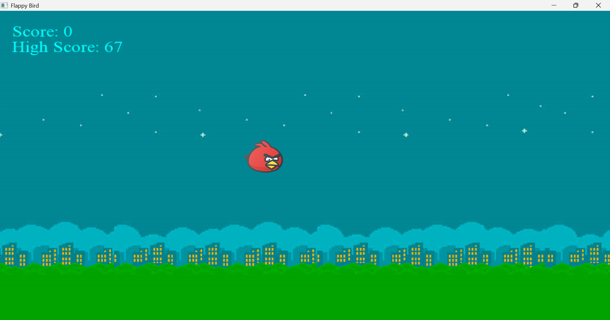
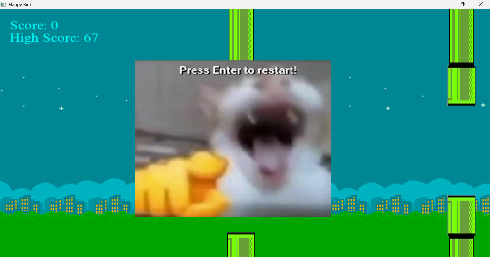

# Flappy Bird – C++ Game

## 1. Project Overview

Flappy Bird is a simple 2D arcade game developed using C++ and the SFML (Simple and Fast Multimedia Library) framework.

The player controls a bird and tries to fly through gaps between moving-style pipe obstacles without colliding with them. The objective is to achieve the highest possible score.

This project was developed as a Programming Fundamentals (PF) course project.

## 2. Team Members

| Name | Student ID |
|---|---|
| Muhammad Ayaan Ahsan | 26L-0818 |
| Abdul Raheem Bhatti | 26L-0819 |

## 3. Features

- Bird movement controlled by keyboard input.
- Pipe obstacles that challenge the player.
- Collision detection between the bird and obstacles.
- Score tracking during gameplay.
- Game-over screen when the player loses.
- Restart option to play again.
- High-score saving using a text file.

## 4. Technologies Used

- **Programming Language:** C++
- **Graphics Library:** SFML
- **IDE:** Microsoft Visual Studio
- **Platform:** Windows
- **Project Type:** 2D Desktop Game

## 5. Programming Concepts Used

This project demonstrates the following programming fundamentals:

- Variables and data types
- Conditional statements
- Loops
- Functions
- Classes and objects
- Event handling
- Collision detection
- File handling
- Basic game logic

## 6. Project Structure

The repository contains the following main files and folders:

- `Final Project.sln` – Visual Studio solution file.
- C++ source files (`.cpp`) – Game implementation.
- Header files (`.h`) – Declarations and game components.
- `library/SFML/` – SFML library files.
- `libraries.txt` – Information about the required library version.
- `screenshots/` – Screenshots of the game.
- `README.md` – Project documentation.

## 7. Requirements

Before running the project, make sure you have:

- Windows operating system.
- Microsoft Visual Studio.
- A compatible SFML version.
- The project source code.
- Required SFML DLL files available when running the application, if needed by your build configuration.

## 8. Installation and Setup

Follow these steps to set up the project:

1. Download or clone this repository from GitHub.
2. Extract the project if you downloaded it as a ZIP file.
3. Open the `Final Project.sln` file using Microsoft Visual Studio.
4. Make sure the SFML library is available in the `library/SFML/` folder.
5. Configure the SFML include and library directories in Visual Studio if they are not already configured.
6. Make sure the SFML version and architecture match the project configuration.
7. Check that the required SFML DLL files are available when running the game.

## 9. How to Build and Run

1. Open `Final Project.sln` in Visual Studio.
2. Select the appropriate build configuration, such as Debug or Release.
3. Select the correct platform, such as x64, matching your SFML libraries.
4. Build the project using **Build → Build Solution**.
5. If the build succeeds, run the application using **Debug → Start Without Debugging** or press `Ctrl + F5`.

## 10. How to Play

1. Start the game.
2. Use the keyboard control implemented in the game to make the bird fly.
3. Guide the bird through the gaps between the pipes.
4. Avoid hitting the pipes or other obstacles.
5. Try to achieve the highest possible score.
6. When the game ends, use the restart option to play again.

## 11. Screenshots

### Gameplay

### Game Over / Restart Screen

## 12. Troubleshooting

| Problem | Possible Solution |
|---|---|
| SFML header files not found | Check the SFML include directory in Visual Studio. |
| Linker errors | Verify that the correct SFML library files are configured. |
| Missing DLL error | Make sure the required SFML DLL files are available beside the executable or in the appropriate system path. |
| Game does not run | Check the build configuration and platform settings. |
| High score is not saved | Check whether the application has permission to write to the required file location. |

## 13. Acknowledgements

We would like to thank our instructor for the guidance and support provided throughout this Programming Fundamentals project.

We also acknowledge the SFML library and its documentation, which helped us implement the graphical elements of the game.

## 14. Conclusion

This project helped us understand how C++ programming concepts can be used to develop a simple graphical game. Through this project, we gained practical experience with event handling, game logic, collision detection, graphics, and file handling.

**Thank you for viewing our project!**
